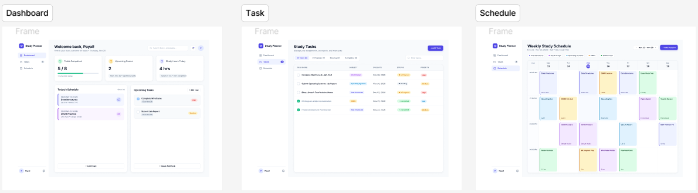
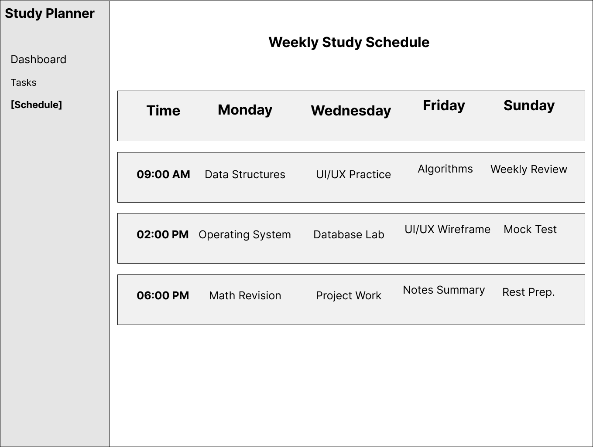

# Challenge 01 – Study Planner Website Wireframe

# About Me
- Name: Payel
- GitHub Username: Payel20072007
- Challenge: Challenge 01

# Figma Project
- Figma Design Link: https://figma.com

# Design Preview

### All Screens

# Design Overview
I designed a low-fidelity grayscale wireframe for a Student Study Planner website with three pages: Dashboard, Tasks, and Schedule. It solves the problem of scattered study plans by organizing daily schedules, task deadlines, and progress tracking into one clean, easy-to-navigate interface.

# Design Decisions & What I Learned
- **Design Decisions:** Used a consistent left navigation sidebar across all three pages, grayscale colors to focus on structure and hierarchy, and clear card and table layouts for scannability.
- **Learning Experience:** I learned how to use frames, shapes, alignment, and typography in Figma to build a multi-page wireframe before adding colors or styling.
-