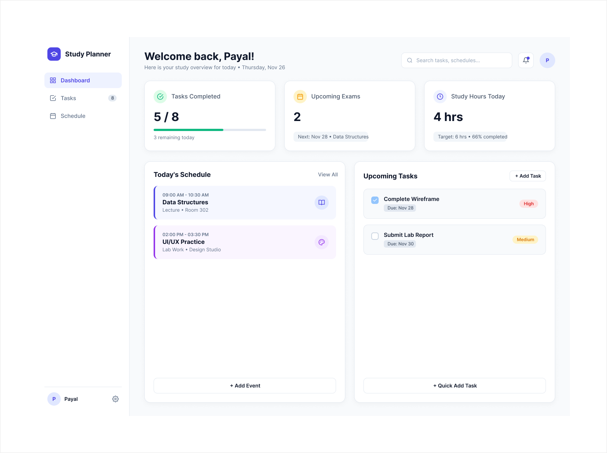
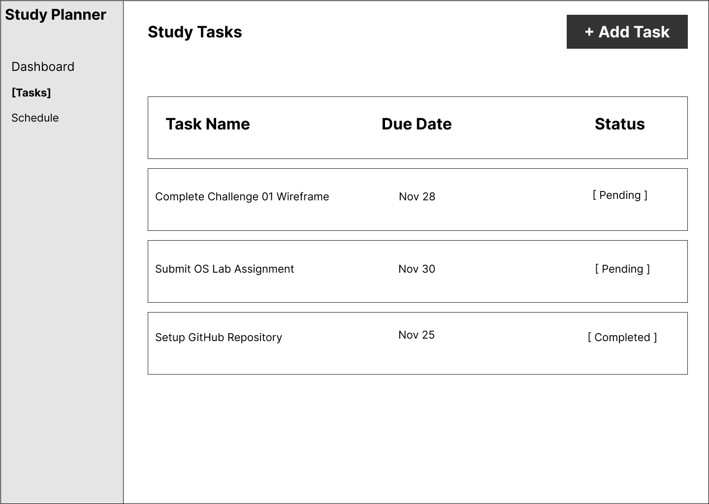

# Challenge 01 – Student Study Planner UI/UX Design

## About Me
- Name: Payel
- GitHub Username: Payel20072007
- Challenge: Challenge 01

## Figma Project
- Figma Design Link: https://www.figma.com/design/ZVtPIxrL74tUascdTnB2oy/Student-Study-Planner---Challenge-01?node-id=21-294&t=WgA3LU7igxYWmcsO-1
- Prototype Link: https://www.figma.com/proto/ZVtPIxrL74tUascdTnB2oy/Student-Study-Planner---Challenge-01?node-id=20-13&t=GVUbo7T1z9KntPiC-1&scaling=min-zoom&content-scaling=fixed&page-id=0%3A1&starting-point-node-id=21%3A3

## Design Preview

### All Screens
- 
- 
- 

## Design Overview
I designed a modern, high-fidelity UI/UX prototype in Figma for a Student Study Planner web application featuring three interactive pages: Dashboard, Tasks, and a 7-Day Weekly Schedule (Monday–Sunday). Using a cohesive Indigo (`#4F46E5`) and soft Slate (`#F8FAFC`) color palette, Inter typography hierarchy, card shadows, status badges, and interactive sidebar prototype links, it organizes daily schedules, assignment deadlines, and study progress into one clean, easy-to-navigate interface.
